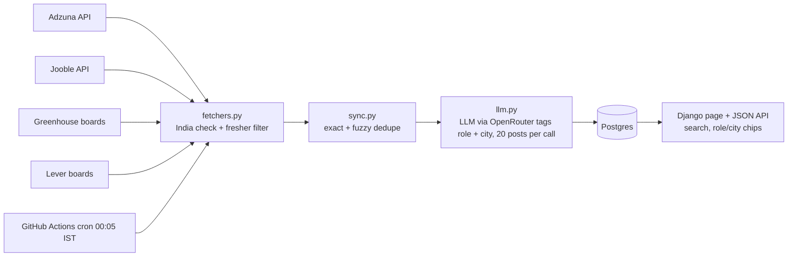

# Beep submission notes

Deadline: **Fri 20 Nov, 11:59 PM**. Form needs: (1) live link, (2) max 5 min Loom with face + screen,
(3) a doc/sheet with the data, AI tools and prompts, plus the repo.

## Your checklist

- [ ] Get keys: create an OpenRouter API key at https://openrouter.ai/keys, plus Adzuna and optionally Jooble. Copy `.env.example` to `.env`; never commit `.env`. For the default free model, a credit top-up is not required.
- [ ] Confirm `LLM_MODEL` is a chat-completions model ID on OpenRouter. The project default is `google/gemma-4-26b-a4b-it:free`; do not configure a Gemini provider URL in `LLM_BASE_URL`.
- [ ] Smoke-test `python manage.py tag_jobs --limit 20` before processing more jobs. On a 429, this client stops the remaining batches for that run.
- [ ] `python manage.py migrate && python manage.py fetch_jobs`. Check the output says 200+ active posts.
- [ ] Deploy (README > Deploy), run the Action once, open the live link.
- [ ] `python manage.py eval_sample`, then **label the 50 posts yourself** in `eval_sheet.csv`, then `eval_score`.
- [ ] `python manage.py cost_report`. Copy the cost per 1,000 posts.
- [ ] `python manage.py export_data --out jobs.csv` and import into a Google Sheet. Add three more tabs: Tools, Prompts, Eval.
- [ ] Record the Loom, fill the form.

## Architecture (say this in the video)

1. **Collect** (`fetchers.py`): 4 source types, run in parallel. A post is kept only if it is in India
   (`places.py`) and is a fresher job (title rules + "3+ years experience" in the description rejects it).
2. **Dedupe** (`dedupe.py`, `sync.py`): layer 1 is a hash of the normalised company + title + city (catches the same job
   on two boards, ignoring "Pvt Ltd", "(m/f/d)", "Internship" vs "Intern"). Layer 2 is a fuzzy title match (>=0.88) inside the same
   company and city.
3. **Tag** (`llm.py`): one OpenRouter call labels 20 new posts as `role` (fixed list of 18) and `city`.
   Output is validated against the taxonomy; a failed batch falls back to the rule-based tagger, so no post is ever untagged.
4. **Serve** (`views.py`, `templates/`, `static/`): server-rendered shell + JSON API, filters for text, role, city, source.
5. **Refresh**: GitHub Actions runs `fetch_jobs` nightly; posts not seen for 7 days are hidden, but never when a whole run returns nothing (outage guard).

## Why these choices (expect questions on each)

- **OpenRouter + a small model, batches of 20:** labelling is easy, so a cheap model is enough, and OpenRouter lets you swap models with one env var and compare them fairly on the same 50 posts. Batching pays the instruction tokens once per 20 posts. `temperature=0` keeps labels repeatable.
- **Fixed taxonomy + validation:** the model cannot invent roles, so filters stay clean.
- **Only new posts are tagged:** the nightly cost is proportional to new posts, not to the whole table.
- **Rules baseline kept:** it is both the fallback and the yardstick: `eval_score` reports AI vs rules on the same 50 posts.
- **Blind sheet:** `eval_sheet.csv` hides the AI tags so you are not anchored by them when you label.
- **No scraping:** see the source table in the README.

## Real problems found while building this (use your own too)

1. 290 of the first 653 jobs were not in India (Germany/US boards): added the India filter and removed those sources.
2. 36 groups of the same job under slightly different text: exact match was too weak, so added normalisation + fuzzy match.
3. "intern" matched "Internal Tools Engineer": switched to word-boundary matching.
4. The "15 second cap" on fetching never worked because the thread pool waited for stragglers: per-request timeouts now.
5. A failed sync during an outage would have hidden old jobs: expiry is skipped when nothing was fetched.
6. A midnight scheduler inside a free web host cannot work (the host sleeps): moved the schedule to GitHub Actions.

## The prompt (also in `jobs/llm.py`, `SYSTEM_PROMPT`)

System: labels fresher posts; role from a fixed list of 18; city canonical spelling (Bengaluru not Bangalore),
first city if several, "Remote" if remote, "India (unspecified)" if only a state, never guess; answer as a JSON object
with a `posts` array. JSON response mode is requested from OpenRouter.
User: a JSON array of `{id, title, company, location, about}` (about is truncated to 1,800 characters when available).

## Cost per 1,000 posts

Use `cost_report`. The client requests usage details with `usage: {include: true}`. OpenRouter returns per-call tokens and cost where provided;
each sync and manual `tag_jobs` run stores those totals for `cost_report`. If a provider omits the cost, the report falls back
to token counts multiplied by `LLM_PRICE_IN` and `LLM_PRICE_OUT` in USD per million tokens.
Back-of-envelope before you have data: roughly 80K input + 22K output tokens per 1,000 posts; multiply by your model's
price on openrouter.ai/models. Replace this with the measured figure.

## Accuracy: how to report it honestly

`eval_score` prints correct/50 for role and city, for the AI and for the rules baseline, with a 95% confidence interval.
With n=50 the interval is wide (about +/-10 points); say so. Report where the AI was wrong (it lists them) and what you would change.

## Likely live-call changes (know where to edit)

| They ask | Edit |
|---|---|
| Add a role | `ROLES` and `_RULES` in `jobs/tagging.py` (prompt updates itself) |
| Add a city | `CITIES` in `jobs/places.py` |
| Add a source | one `fetch_x()` in `jobs/fetchers.py` + a line in `_tasks()` |
| Change the sync time | `AUTO_SYNC_AT` in settings and the cron line in `.github/workflows/daily-sync.yml` |
| Change the model | `LLM_MODEL` env var (any OpenRouter model id) |
| Stricter duplicates | `FUZZY_THRESHOLD` in `jobs/dedupe.py` |

## Not verified from this build environment

Live API calls to the public job sources and OpenRouter, the Postgres connection and the Render deployment still require a real
credentialed smoke test. Run those checks once before recording. Automated unit tests should pass in the project's virtual environment.
